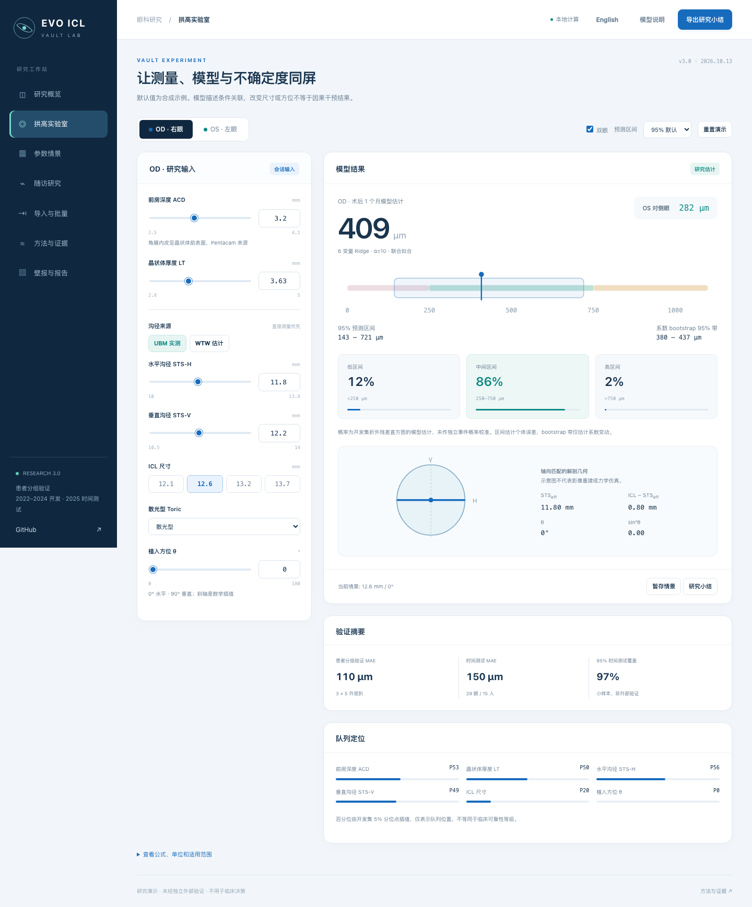

# EVO ICL · Vault Lab

Research demonstrator 3.0 · 2026-10-14

[Open the website](https://calculator.evo-icl.cn) · [Model card](docs/model-card.md) · [Research report](docs/research-report.md) · [Poster plan](docs/poster-plan.md)

An ophthalmic research workspace with a jointly fitted, interpretable one-month vault model, patient-grouped validation evidence, synthetic scenario exploration, longitudinal experiments and a reviewable poster.



**Research use only. Not clinically validated and not for patient care.** The interface does not determine surgical eligibility or recommend ICL size/orientation. A change to a model input is not an established causal treatment effect.

## 中文

### 本次更新

- 从原始登记表重新抽取并清洗；明确 399 眼登记队列、397 眼早期终点、379 眼 1 月终点及 370 眼完整参数模型队列。
- 2022–2024 年 341 眼 / 173 个患者记录开发；2025 年 29 眼 / 15 个患者记录保留为时间测试。
- 11 个候选，外层重复 3×5 折患者分组、内层 4 折调参；缺失处理/尺度转换不跨折。
- 默认 6 变量 Ridge α=10，替换旧锁定系数 + 样本内方位残差修正。
- 内部 MAE **110.3 μm**、R² **0.303**；时间测试 MAE **149.7 μm**。不能拿新口径直接与旧报告的数字比较。
- 标称 80% 区间时间覆盖仅 **65.5%**；默认改为 95%，其时间覆盖 **96.6%**。概率为残差模型估计，未独立校准。
- 实测 1 个月值参与的独立 6 个月随访研究模型：同批 281 眼分组 CV MAE **60.5 μm**，不作术前预测。
- 当前网站移除真实逐眼行，改用公开汇总、残差直方图、模型对象和合成示例。未重写 Git 历史，旧提交可能仍含旧的嵌入数值行。

### 工作区

研究概览、拱高实验室、参数情景、随访研究、导入与批量、方法与证据、壁报与报告。支持左右眼、滑块/数字同步、实测 UBM/明确标注的 WTW 回退、概率与区间、解剖几何、敏感性、队列定位、情景暂存、配对随访曲线、文本与图片/PDF识别、CSV/TSV、独立数据描述性评分、JSON、主动确认的合成参数分享、HTML/打印 PDF 和数值自检。

参考 ZEISS FORUM / HEYEX 2 的并排视图与工作区组织，使用独立设计，无厂家关联。所有输入仅在会话内存中；无需 localStorage/sessionStorage。OCR/PDF 首次使用下载第三方运行文件，输入图片/文本在浏览器处理，不上传到本项目服务器。

### 壁报

[A0 草稿 PDF](poster/ICL_A0_draft.pdf) · [可编辑 HTML](poster/poster.html) · [摘要与选题计划](docs/poster-plan.md)

综合眼科/屈光场次有条件适合；若目标会议限定低视力人群康复，当前解剖终点匹配较弱。保留 ICL 项目，优先补随访与真实视觉功能结局。确切目标会议规格、作者/医院/伦理元数据尚待研究方提供，未自动投稿或宣称接收。

### 模型

```text
Vault_1m = −965.2343 + 161.3360·ACD + 214.2711·ICL
           + 22.5011·Toric − 101.6025·LT
           − 126.7614·STS_eff − 75.2541·sin²θ
STS_eff = 1 / sqrt(cos²θ/STS-H² + sin²θ/STS-V²)
```

mm 输入 / μm 输出；Toric 0/1。全精度、300 次患者 bootstrap 系数及验证元数据位于 `assets/model.json`。

已知边界：单中心；记录组不一定等于经可靠身份标识核实的独立患者；方位的光学轴/物理长轴对应需要术者复核；CLR/STSL 未测；无独立中心验证；斜轴、WTW 回退与队列边缘区间未分别验证；旧显著尺寸×方位交互未稳健复现。本软件不能证明视觉康复疗效。

## Run locally

Open `index.html` directly for the core interface, or use a static server:

```bash
python3 -m http.server 8765 --bind 127.0.0.1
# http://127.0.0.1:8765/
node --test tests/model.test.cjs
```

Core computation has no runtime network dependency. PDF/OCR uses pinned PDF.js 4.10.38 and Tesseract.js 6.0.1 from jsDelivr on explicit use. A modern browser is required.

## Reproduce the research

The workbook contains clinical data and is **not included**. Obtain authorized access independently. The original input is never modified.

```bash
python3 -m venv .venv
.venv/bin/pip install -r analysis/requirements.txt
.venv/bin/python analysis/reanalyse.py --workbook /local/authorized/registry.xlsx
.venv/bin/python analysis/outcome_inventory.py --workbook /local/authorized/registry.xlsx
.venv/bin/python analysis/make_figures.py
.venv/bin/python analysis/build_bundle.py
```

On macOS XGBoost requires OpenMP. The analysis reports an unavailable XGBoost import explicitly rather than inventing a score. Exact versions used are recorded in `research/results.json`.

`research/results.json` and figure files are aggregate outputs. No identifiers, notes, workbook or reconstructed per-eye dataset is written by the pipeline. Feature mapping is documented in `analysis/read_registry.py`; pre-fit plan in `docs/analysis-protocol.md`.

Optional browser checks: install Playwright and run `node tests/browser.cjs` against the local server. To use an existing Playwright module, set `PLAYWRIGHT_MODULE`; output directory is controlled by `VAULT_QA_DIR`.

`node tests/import-browser.cjs` additionally downloads the pinned optional engines and checks a synthetic PDF and image. The supplied poster can be regenerated with `python analysis/build_poster.py`, then `node analysis/render_poster.cjs`. To rebuild its Chinese font subset, set `POSTER_FONT` to an authorized Noto Sans SC TTF; the supplied subset is distributed under `poster/FONT-LICENSE.txt`.

## English overview

The default model is a jointly fitted six-feature Ridge, trained only on 2022–2024. Repeated nested patient-grouped CV yields MAE 110.3 μm and R² 0.303; the small same-centre 2025 temporal test yields MAE 149.7 μm. It is not an independent-centre external validation.

Empirical CV-residual intervals are not distribution-free conformal guarantees. Temporal coverage was 65.5% for nominal 80% and 96.6% for nominal 95%, so the interface defaults to 95%. Range probabilities are not independently calibrated event probabilities. Coefficient bootstrap bands differ from individual prediction intervals.

A separate exploratory six-month model requires observed one-month vault; its grouped internal CV uses 281 paired eyes and is never presented as preoperative prediction. Clinical outcome definitions, ethics, data authority and poster authorship require the study team's confirmation.

### Code and data policy

MIT applies to code. It does not grant clinical data rights or establish clinical authorization. The current release contains aggregate research objects and synthetic examples; legacy Git history is retained. Citation metadata describes software, not an accepted publication.
